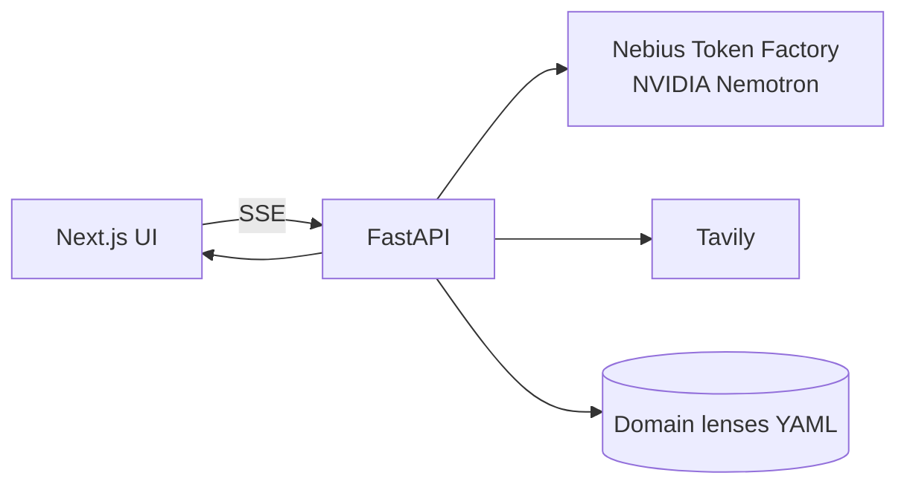

# Peperio

**A panel of AI agents that tries to find every reason your product idea could fail, before you spend months building it.**

Peperio is a pre-mortem tool: imagine the project has already failed, then work backward to explain why.
Paste an idea. AI critics and 40 simulated customers attack it using cited web evidence. You get a survival
score *with a range*, the fatal flaws, and the cheapest test for each one. One click rewrites the idea and
checks whether it really improved.

> Hackathon track: **Best Apps and Agents** · Built on **Nebius Token Factory** with **NVIDIA Nemotron** models · Evidence via **Tavily** · MIT licensed

> *Every other idea-roaster gives you a score; Peperio tells you how much to trust it.*

## Contents
[Why a tool, not a chat](#why-a-tool-not-a-chat) · [How it works](#how-it-works) · [Agents](#agents) · [Credibility engine](#credibility-engine) · [Side-by-side comparison](#side-by-side-against-a-single-prompt) · [Architecture](#architecture) · [Tech stack](#tech-stack) · [Getting started](#getting-started) · [Nebius and NVIDIA tools](#nebius-nvidia-and-tavily) · [Honest limits](#honest-limits) · [Team](#team) · [Repo layout](#repository-layout) · [Progress](#progress-and-contributing) · [License](#license)

## Who it's for
Product managers testing a feature before the roadmap, first-time founders who want an honest second opinion, and students choosing what to build.
- **Ayesha**, a PM with a director meeting next week, wants the three hardest questions in advance.
- **Bilal**, a founder planning meal kits for gym-goers, whose friends all say "great idea".

## Why a tool, not a chat
A well-prompted chat can write four role prompts and a score. Peperio does what one reply cannot:
- **Retrieves evidence at run time** (Tavily) and cites it, so claims are checkable.
- **Samples independently**: 40 separate calls with distinct personas, not one model writing 40 personas in one context (which collapses into near-clones).
- **Measures itself**: runs the judge several times and reports a score range, not one lucky number.
- **Proves itself on known cases**: a backtest on startups whose outcome we already know.

## How it works
1. **Paste and structure.** A fast model turns the idea into an editable **Idea Canvas** (who it's for, problem, solution, price, riskiest belief, market). Missing fields are flagged; no price means Finance treats pricing as unknown.
2. **Gather evidence.** A router tags the domain and picks the claims worth checking; Tavily searches each; the result is a numbered evidence pack `[S1..Sn]`.
3. **Debate, streaming live.** Four critic cards fill in token by token while 40 customer dots turn green (would pay), yellow (maybe) or red (no).
4. **Verdict.** The Ultra judge runs three times and returns a survival score with a range, the top 3 fatal flaws, the assumptions that must be true, a cheap experiment per flaw, and a **BUILD / PIVOT / KILL** recommendation.
5. **Resurrect.** The idea is rewritten to fix the flaws and re-tested; the gain counts only if it beats the noise (up to 3 rounds).
6. **Share.** A downloadable "cause of death" card, plus a live panel of tokens, latency and cost per model tier.

## Agents

| Agent | Job | Tier | Count |
|-------|-----|------|-------|
| Skeptical user | Why a real customer would not bother | Fast Nemotron | 1 |
| Competitor analyst | What people use instead, where the idea loses | Fast Nemotron | 1 |
| Engineer | Technical risk, hidden complexity, build cost | Fast Nemotron | 1 |
| Finance lead | Pricing, market size, unit economics | Fast Nemotron | 1 |
| Segment maker | 8 customer types: 2 early adopters, 3 mainstream, 3 skeptical | Fast Nemotron | 1 |
| Simulated customer | One persona with a budget says pay, maybe or no, and why | Fast Nemotron | 40 |
| Judge | Reads everything, scores, picks flaws, writes experiments | Ultra Nemotron | 3 runs |
| Rewriter | Fixes the top flaws without inventing facts | Ultra Nemotron | 1 per Resurrect |

Customers are **simulated guesses, never market research**, and are labelled that way everywhere. Counts of pay / maybe / no are computed in code, not by the model.

## Credibility engine
1. **Idea Canvas**: structured fields extracted from pasted text; the user edits them.
2. **Domain router**: tags the domain and lists 4-6 claims worth checking (competitor pricing, regulation, market size, incumbent behaviour).
3. **Tavily evidence pack**: one query per claim (under 400 chars, max 6 per run, cached) → numbered `[S1..Sn]` with title, URL, snippet, date.
4. **Domain lens**: a small YAML file per field listing its usual failure modes (e.g. fintech: licensing, KYC, fraud, interchange). Ten lenses plus a generic fallback, written as data.
5. **Critics and customers**: critics must cite `[S#]` or tag a claim `ASSUMPTION`. Customers use an objection-first schema with a stated budget and an existing tool they would have to drop; "maybe" is allowed only with one named condition.
6. **Claim verifier**: code checks every cited ID exists; a Nano model checks the snippet supports the claim. Unsupported claims are dropped or flagged. The UI shows an **evidence coverage** meter.
7. **Ultra judge, 3 runs**: median with min-max range. Weak or sparse evidence widens the range and softens the recommendation.
8. **Resurrect with a noise floor**: code flags any new number or named entity not in the original idea or evidence. A gain is reported only if the new median beats the old maximum; otherwise: "no reliable change".
9. **Backtest page**: 16-20 historical ventures (about half failed, half survived) as name-stripped pitch-stage descriptions, plus 4 absurd controls. Pairwise ranking accuracy per setup. Models may recognise famous cases, so this is a sanity check, not proof.

## Side-by-side against a single prompt
Same idea, same Nemotron model, so any difference comes from architecture.

| Setup | What it is | What it isolates |
|-------|-----------|------------------|
| A. Single prompt | One mega-prompt: "act as four critics and 40 customers, score it" | The chat everyone already has |
| B. Single prompt + same evidence | Same prompt given the Tavily evidence pack | What retrieval alone adds |
| C. Peperio | Full pipeline | What independence, verification and repetition add |

Measured, not claimed: **stability** (A ×5 vs C ×5 score spread), **grounding** (claims with verified sources), **crowd diversity** (distinct objections after clustering, share of "pay"), **backtest accuracy**. If the baseline wins on something, we report it.

_Results: TBD, filled from real runs only._

## Architecture
Full diagrams: **[docs/ARCHITECTURE.md](docs/ARCHITECTURE.md)** (components, sequence) and **[docs/ERD.md](docs/ERD.md)** (entities and data flow).



## Tech stack
- **Backend:** Python, FastAPI with streaming (SSE), Pydantic-enforced JSON output
- **LLM:** OpenAI Python SDK pointed at Token Factory; model IDs read from `GET /v1/models` at startup (never hard-coded)
- **Evidence:** Tavily API
- **Frontend:** Next.js (Streamlit as fallback)
- **Hosting:** Nebius Serverless Endpoint, per-visitor rate limit, recorded-replay fallback
- **Secrets:** `.env`. **License:** MIT. Out of scope: accounts, saved history, payments.

## Getting started
> Scaffolding is in progress; commands below are the target interface.

```bash
git clone https://github.com/Ayesha123-kh/nvidia-hackathon.git
cd nvidia-hackathon
cp .env.example .env        # add TOKEN_FACTORY_API_KEY, TOKEN_FACTORY_BASE_URL, TAVILY_API_KEY
# backend
cd backend && pip install -r requirements.txt && uvicorn app.main:app --reload
# frontend
cd frontend && npm install && npm run dev
```

## Nebius, NVIDIA and Tavily
- **NVIDIA Nemotron**: all reasoning. Fast tier for critics and customers, Ultra tier for the judge and rewriter.
- **Nebius Token Factory**: OpenAI-compatible inference for every model call; live tokens, latency and cost per tier are shown in the HUD.
- **Nebius Serverless Endpoint**: hosts the app.
- **Tavily**: real runtime search that grounds every factual claim.

Our running notes on these tools are in [feedback-notes.md](feedback-notes.md).

## Honest limits
- Customers are **simulated**, not market research.
- Accuracy was tested on **three domains** (fintech, healthcare, food delivery), not all.
- Evidence depends on **what Tavily finds**.
- Backtest cases may be recognised by the model; it is a sanity check, not proof.
- Real-user test is a **small sample** (8-10 ideas) and reported as small.

## Team
| Person | Owns |
|--------|------|
| Ashi | Pipeline, evidence, verifier, deploy |
| Faisal | Backtest harness and metrics |
| Saad | HUD, score-range chart, backtest page |
| Zarlishta | Domain lens files, example ideas, README draft |
| Danyal | Test matrix, real-user collection, video, submission checklist |

## Repository layout
Branches: `main` (stable), `staging` (integration), `saad`, `zarlishta`, `faisal` (personal work branches; PR into `staging`).
```
backend/  frontend/  backtest/  recordings/  docs/  .github/
```

## Progress and contributing
Work is tracked in **GitHub Issues** (label `task`, `day-*`, owner label) with a checklist in [TRACKER.md](TRACKER.md). Internal target Oct 26, submit Oct 29, hard deadline Oct 30, 22:00 PKT.

## License
[MIT](LICENSE)
