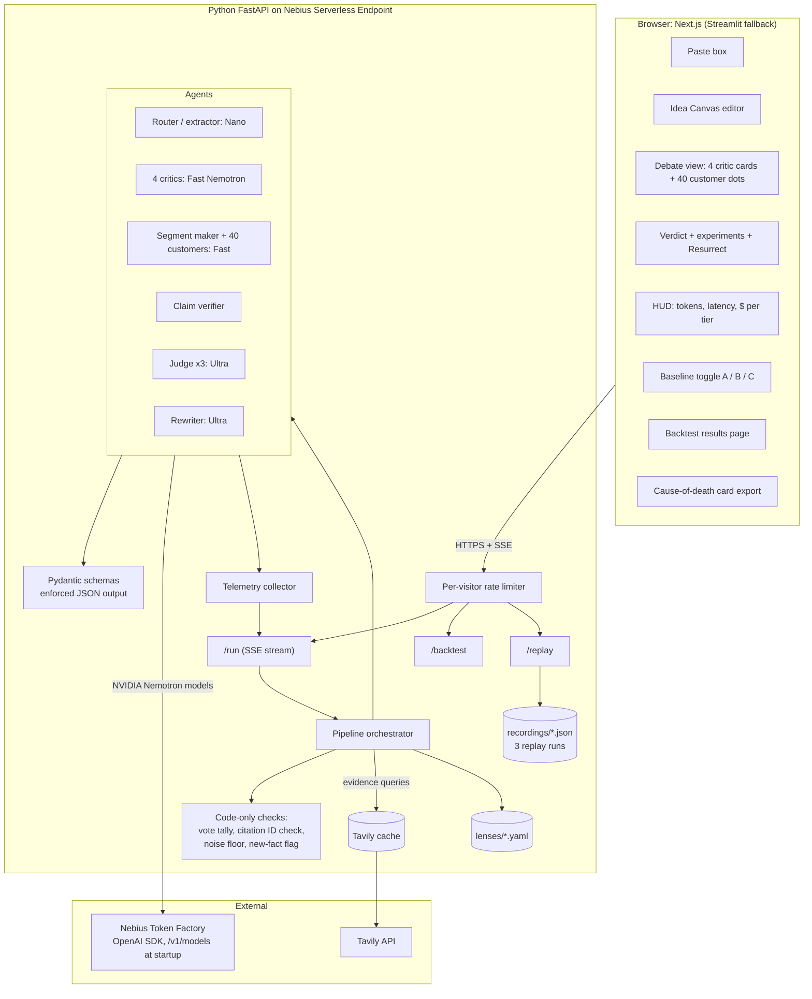
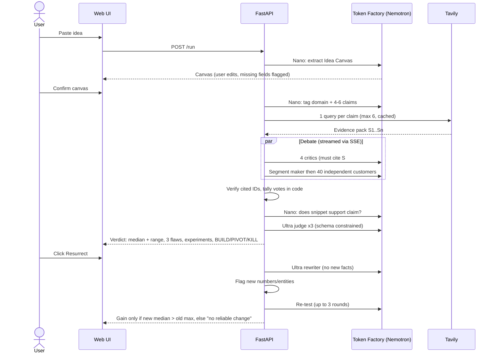

# Peperio: System Architecture and Workflow

## Components



## Workflow (one run)



## Design decisions

| Decision | Why |
|----------|-----|
| Tavily before critics | Claims are checkable; this is what a chat cannot do |
| 40 separate customer calls | Independence; one call writing 40 personas collapses into clones. Micro-batching only as a labelled fallback |
| Judge runs 3 times | Report a range, not one lucky number |
| Counts in code | Pay / maybe / no counts are never model-generated |
| Domain lens as YAML | Add a domain by adding data, not code |
| Model IDs from `GET /v1/models` | The dossier's IDs are unverified |
| Rate limits read from response headers | The 60 RPM figure is unverified |
| Replay mode | Keeps the demo alive if credits run out |

## Planned repo layout

```
backend/        FastAPI app, agents, pipeline, schemas, verifier
backend/lenses/ domain lens YAML files (10 + generic)
frontend/       Next.js UI (Streamlit fallback)
backtest/       harness, cases, metrics
recordings/     3 saved full runs for replay mode
docs/           ERD, architecture
```
