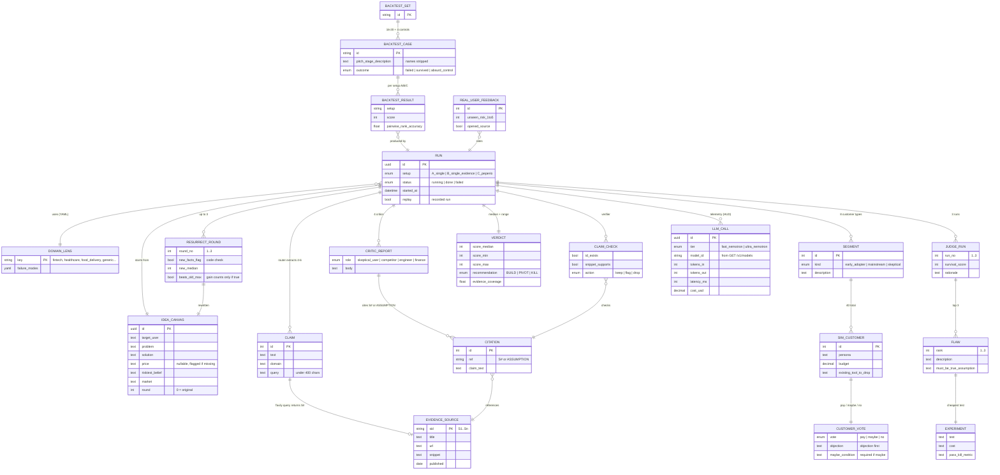

# Peperio: Entity Relationship Diagram and Data Flow

Peperio has **no accounts, saved history or payments** (out of scope). Entities below are the
Pydantic models that move through one run. They can be held in memory per run and
serialised to JSON for replay recordings and backtest results.

## ERD

## Data flow (what moves where)

```mermaid
flowchart LR
    U[User pastes idea] --> N1[Nano: extract]
    N1 --> IC[(Idea Canvas<br/>editable)]
    IC --> RT[Nano: domain router<br/>+ 4-6 claims]
    RT --> TV[Tavily search<br/>1 query per claim, cached]
    TV --> EP[(Evidence pack S1..Sn)]
    RT --> LENS[(Domain lens YAML)]
    IC & EP & LENS --> CR[4 critics<br/>Fast Nemotron]
    IC & EP --> SEG[Segment maker<br/>8 types]
    SEG --> CU[40 independent customer calls<br/>Fast Nemotron]
    CU --> TALLY[Code: count pay / maybe / no]
    CR --> CV[Claim verifier<br/>code + Nano]
    EP --> CV
    CV --> COV[Evidence coverage meter]
    CR & TALLY & CV --> J[Ultra judge x3]
    J --> V[Verdict: median + range,<br/>3 flaws, experiments, BUILD/PIVOT/KILL]
    V --> RW[Rewriter Ultra<br/>no invented facts]
    RW --> NF{Code: new numbers<br/>or entities?}
    NF --> RE[Re-test, up to 3 rounds]
    RE --> GAIN{new median > old max?}
    GAIN -- yes --> OUT1[Reported gain]
    GAIN -- no --> OUT2["no reliable change"]
    V --> CARD[Cause-of-death card]
    LLM[(LLM_CALL telemetry)] --> HUD[Live HUD]
```

